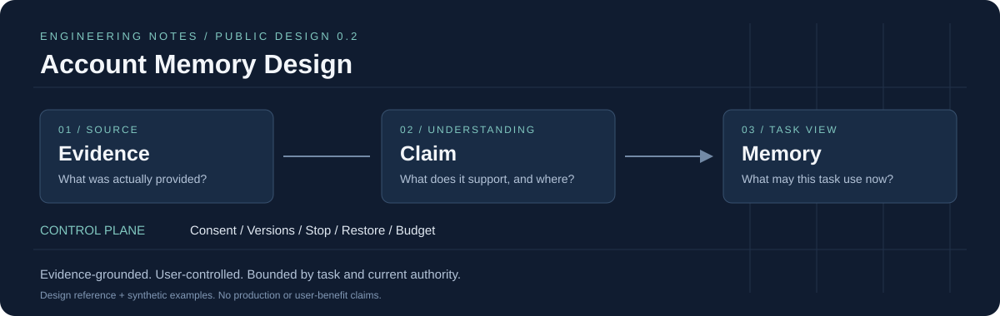

# Account Memory Design



**一份从用户体验推到数据、并发、恢复与成本的账号级 AI 记忆系统设计。**

A field guide to evidence-grounded, user-controlled memory across conversations and agents.

公开设计版 **v0.3.0** · 简体中文为主 · 主设计＋匿名深度分析＋逐项采用边界

用户说“工作讨论请直接一点，倾诉时先别急着给建议”，AI怎样记住其条件，而不是贴一个固定人格标签？用户随后纠正，另一个窗口已经在生成怎么办？删掉原聊天后哪些记忆还能保留？恢复旧备份又怎样避免复活？

本项目围绕这些问题展开。它提供产品需求、领域模型、工程合同、完整故事、接口/Schema示例、故障推演与可复算的容量费用模型。它**尚未提供可部署记忆服务**；数据库、多实例、真实模型、人工评审和用户收益需要分别验证。

本版结合多份个人记忆原型与人物理解规格，补充[深度模式分析](docs/deep-dive/11-source-integration.md)、[统一术语与冲突处置](references/UNIFIED-INTERPRETATION.md)、[105类概念承接表](references/FIELD-CROSSWALK.md)。内容以匿名综合整理呈现，不附其他人的原文件或出处，不将外部报告当作本项目验证。

## 建议先读

- **想理解参考机制和采用理由**：读[匿名分析入口](references/README.md)、[完整模式分析](docs/deep-dive/11-source-integration.md)及[105类概念处置](references/FIELD-CROSSWALK.md)。
- **想完整理解设计**：从[《从记住一句话到可治理的长期状态》](docs/deep-dive/01-memory-as-governed-state.md)开始，再读[12轮完整故事](docs/deep-dive/02-complete-story.md)。
- **准备做产品或开发评审**：读[产品概览](docs/01-product.md)、[状态/API/存储](docs/deep-dive/03-api-and-storage.md)、[并发与恢复](docs/deep-dive/04-concurrency-and-recovery.md)。
- **研究召回和Agent协作**：读[检索与上下文](docs/deep-dive/05-retrieval-and-context.md)、[A2A边界](docs/deep-dive/06-a2a-and-agent-boundaries.md)、[路线取舍](docs/deep-dive/08-patterns-and-tradeoffs.md)。
- **判断是否值得上线**：读[阶段验收](docs/06-acceptance.md)、[评测方法](docs/deep-dive/07-evaluation.md)、[容量经济性](docs/deep-dive/09-capacity-economics.md)。

## 这个设计的几个关键判断

| 常见做法容易漏掉什么 | 本设计怎样处理 | 详细说明 |
|---|---|---|
| 一段摘要混合原话、AI解释与计划 | Evidence、Claim、Memory与Action分别表达 | [模型与状态](docs/03-contracts.md) |
| 用户确认被当成真值或全面授权 | 确认、支持、性质、生命周期、用途分开 | [技术长文](docs/deep-dive/01-memory-as-governed-state.md) |
| 纠正事务失败让已否定解释恢复 | 独立停止先成立，替代内容单独回执 | [故障推演](docs/deep-dive/04-concurrency-and-recovery.md) |
| 索引没刷新就漏新更正 | 连续水位与有界权威增量合并 | [检索计划](docs/deep-dive/05-retrieval-and-context.md) |
| 删除仅主表隐藏，旧备份仍复活 | 根/域屏障、分副本清理、独立登记、恢复先重放 | [并发与恢复](docs/deep-dive/04-concurrency-and-recovery.md) |
| 内部Delta省字节就声称省模型费 | 装配、传输、计费输入与总调用分别计量 | [成本推导](docs/deep-dive/09-capacity-economics.md) |
| 子Agent/另一入口默认全可信 | 父任务、目的、接收方、来源、期限和预算共同限制 | [A2A边界](docs/deep-dive/06-a2a-and-agent-boundaries.md) |

## 内容地图

| 路径 | 内容 |
|---|---|
| [docs/01-product.md](docs/01-product.md) 至 [09-references.md](docs/09-references.md) | 产品、架构、合同、33字段、工程、32组待实施验收、容量和取舍概览 |
| [docs/deep-dive/](docs/deep-dive/01-memory-as-governed-state.md) | 11篇连续深度章节，从设计理由到完整工程/评测边界 |
| [references/](references/README.md) | 匿名参考机制、统一解释与105类概念逐项对照；不附原文件 |
| [schemas/](schemas/proposal.schema.json) | 3份JSON Schema：模型提案、五段上下文、复合纠正回执 |
| [api/openapi.json](api/openapi.json) / [操作清单](api/operations.json) | 9个接口的评审参考，含版本、错误与用途边界 |
| [examples/](examples/README.md) | 虚构的生命周期、结构样例和容量费用参数；另含明确标识的离线检查记录 |
| [tools/](tools/check_publication.py) | 文档检查、结构样例检查、容量与归一化费用复算 |

字段目录初始建议21开/12关；不为每个用户填满画像，也不默认开启量表、稳定特质、发展研究、私聊训练或心理画像A2A共享。模型只能提出有限候选，不能授予确认、Grant、核验或现实行动成功。

## 可以在本地做什么

基础文档检查与算例只依赖Python标准库，建议Python3.10或更新版本：

```bash
python3 -B tools/check_publication.py
python3 -B tools/check_design_integration.py
python3 -B tools/capacity_model.py examples/capacity-scenario.json
python3 -B tools/cost_sensitivity.py
```

可选结构检查使用独立虚拟环境：

```bash
python3 -m venv .venv
.venv/bin/python -m pip install -r requirements-dev.txt
.venv/bin/python -B tools/check_contract_examples.py
```

检查3份Schema的meta结构、虚构正反例、9接口清单与本地引用。**结构合法不等于来源真实或有权使用**：等长伪原话、旧许可版本、总预算不足和支持不足都需要运行时继续检查。具体[检查范围与已知边界](docs/deep-dive/10-machine-contracts.md)及[结果](examples/contract-check-results.json)单独保留。

匿名整理与105类概念检查只校验公开结构和目标政策一致，结果见[检查记录](examples/design-integration-check-results.json)；没有验证原件、运行外部软件或执行产品案例。

费用工具用归一化虚构单位；不是当前报价、真实账单或压测。多字段、更长摘要或更多Agent不会自动带来更高收益，最终以同任务、同来源和预算的对照判断。

## 分享与贡献边界

本仓库分享通用设计与匿名综合分析，不上传其他人的原文件、出处和原工程，也不纳入业务源码、私人对话或内部运行／审批材料。对要求保留署名的材料采用独立表述的分析，不做去署名转载。详见[公开范围](PUBLICATION.md)及[匿名分析入口](references/README.md)。

欢迎用Issue讨论矛盾、遗漏、成本和可复现的合同问题，请使用虚构示例。[贡献说明](CONTRIBUTING.md)列出范围。本次公开分享仍未选择开放许可；公开可读不等于替第三方材料重新授权。
