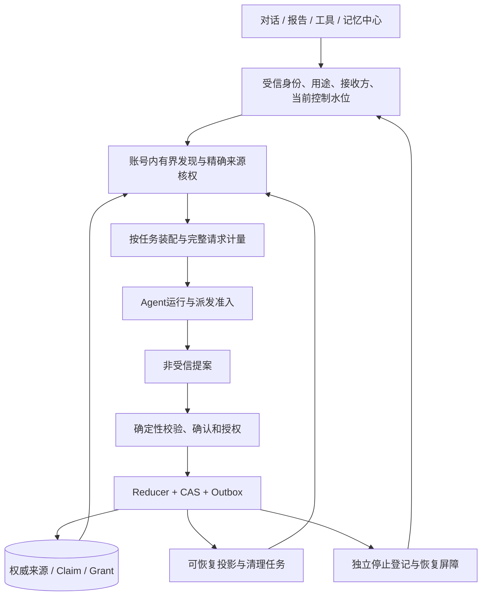

# 架构：一个权威域，多种受限投影

图中的组件表示职责，不要求立即部署成多个微服务。初期可以采用模块化单体、事务数据库和有界后台任务，再按实际容量与故障隔离需要拆分。

## 核心边界

| 层 | 负责什么 | 不能代替什么 |
|---|---|---|
| 来源与证据 | 原话、观测、时间、主体、谱系与独立组 | 摘要不成为独立事实根 |
| Claim与版本 | 当前说法、性质、支持、范围、冲突与修订 | 相关性高不代表真实、confirmed不代表verified |
| 授权与控制 | 用途、接收方、期限、撤回、删除水位 | 模型或客户端owner/grant字符串不构成权限 |
| 检索与投影 | 用途受限的当前视图、索引与缓存 | 不是第二个权威人物库 |
| 运行与交付 | 预算、派发、恢复、真实回执与最终提交 | 输出提交不证明外部行动完成或记忆保存成功 |

## 最小内部端口

Authority.check校验受信身份、用途、来源和当前水位；Discovery.search返回有界候选引用；Source.resolve二次核权读取最小正文；Proposal.prepare/Reducer.apply处理类型化更新；Context.assemble/Admission.check绑定真实请求与预算；Control.stop/Delete/Recover处理退出与恢复。

旧记录继续按旧合同解释，新合同通过唯一映射接续。新Claim为权威时，旧结构只能成为兼容投影，不能有两套独立写器竞争。回退计算策略不得回退授权、删除水位或恢复已经停用的旧投影。

## 上下文五段

`current_task`保当前意图和否定；`applicable_background`只保必要有效背景；`confirmed_changes`表达有据的状态变化；`relevant_recall`保相关事件及有边界假设/反例；`critical_boundaries`保关键纠正和适用边界。

五段不是五次调用或五份永久档案。停止/删除要实际移除旧正文，或使用干净上下文重建；向旧历史追加“忽略上文”不能替代移除。预览与最终派发使用同一装配器，输入/版本变动后重新核权、计量和绑定。

## A2A

同账号子Agent也受父任务、用途、来源、接收方、期限、删除水位和预算限制；回写只形成提案。跨账号只传双方分别授权的必要投影，不直接透传人物档案或原始私聊。

协议层处理身份、任务、取消、重试和产物；记忆域只认内部受限投影合同。远程收到停止/清理通知不等于可核验物理删除，远程未知应如实保留。记忆读取许可不包含代发、代约或付款等行动权限。
