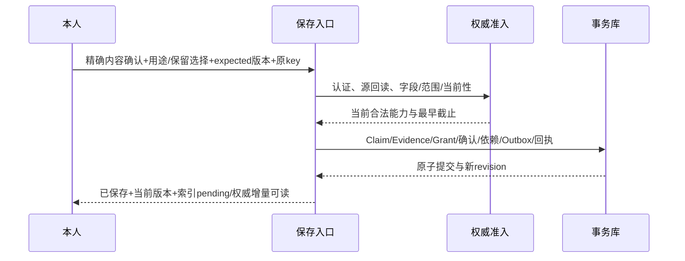

# 完整故事：从一句偏好到纠正、删除和恢复

这里的用户、对话、对象、时间、许可和操作全部虚构。本故事用来检查产品与工程是否表达同一承诺；表格中的结果是预期，不是服务实跑日志。

## 初始条件

账号A是已认证本人，入口包括对话窗口和报告工具。当前许可只覆盖本轮处理；未默认启用候选落盘、长期个性化、第三方分享或训练。

| 对象 | 初始状态 |
|---|---|
| 共享读取设置 | 关闭，没有可读长期记忆 |
| 新候选设置 | 允许从本轮产生候选，不含持久许可 |
| 自动整理 | 关闭 |
| model_revision / consent_version / deletion_epoch | 示例起点1 / 1 / 0 |
| 人物 | 仅本域本人引用，不建立真实外部账号关系 |

## 第1轮：只表达偏好

用户：“工作讨论请直接一点；我只是倾诉时，先别急着给建议。”

当前回答可以尊重这次明确偏好。抽取器把原话拆成两项reported候选，分别限定工作讨论和倾诉情境；不能改写成“这个人永远喜欢直接沟通”或“抗压能力低”。

```text
Evidence example-e1: 原话+源版本+代码点坐标+本人说话者
Claim候选A: preference.communication=工作讨论直接一点，context=work
Claim候选B: preference.communication=倾诉先接纳，context=venting
save_state=not_requested
```

这时没有长期记忆提交。若页面关闭且无候选保留许可，不能在失败队列里暗留整份候选。

## 第2轮：认同内容，但没有授权保存

用户：“对，就是这个意思。”

如果认证动作与精确候选能明确绑定，可以记录内容confirmed；普通附和无法自动绑定时仍应核对。即使内容确认成立，长期用途和保留许可也不会自动出现。

| 维度 | 预期 |
|---|---|
| confirmation | confirmed（仅在精确绑定成立时） |
| lifecycle | proposed |
| save_state | awaiting_grant |
| pending_requirements | source_retention_grant、long_term_grant等实际缺门 |
| 用户文案 | “表达已确认，尚未保存为跨会话记忆” |

不要反复要求用户认同已经确认的内容；缺什么就说明什么。

## 第3轮：明确选择保存

用户在保存卡选择两条内容、用途和期限，启用已列入口的共享读取。卡片说明独立保留的最小原话及删除原聊天的影响。



用户卡片中的多个选择可在一个UI动作提交，后端仍分别保存内容确认与Grant。真实事务未提交前，不显示“已经记住”。

## 第4轮：换入口，索引尚未追平

用户在报告工具请求：“帮我整理明天工作沟通的重点。”

宿主绑定当前用途、接收方、任务和账号；只召回工作讨论偏好，不为了充实上下文顺带加载倾诉内容。搜索结果合并确认后的权威增量，所以刚保存的信息不必等待索引刷新。

使用回执分别说明：发现哪些候选、哪些来源成功读取、哪条偏好实际入模、输出是否引用。报告生成成功不证明用户最终按建议行动。

## 第5轮：AI提出过度解释

模型：“你可能是在回避被挑战，所以倾诉时不希望得到建议。”

这属于推断，不是第1轮自述的同义改写。它不应因为来源存在就自动获得supported，也不能伪装成用户已经保存的认识。若材料不足，应避免用它驱动个性化建议；必要时仅表达未知并澄清。

假设存在一个供本轮审阅的候选example-h1，需保持inferred/proposed、局部范围、支持不足及替代解释，长期使用关闭。后述并发复核变体还要求用户另行允许该议题的有期候选审阅，窗口B只能将其作为当前核对材料，不能作为长期个性化依据；没有该许可时，候选只在原本轮临时存在，不能跨窗口读取。

## 第6轮：用户否定并补充

用户：“不是回避挑战，不要再用这个解释。我只是下班后太累。”

明确拒绝example-h1不要求先证明一个相反人格结论。先阻断旧解释及依赖，再准备新的本人状态说明。是否长期保存后半句仍取决于本人选择与保留许可。

| 子操作 | 成功后的状态 | 此时不能声称 |
|---|---|---|
| stop old understanding | new_use_state=blocked、独立登记durable | 新说明一定已保存 |
| prepare replacement | reported状态候选，source为新本人输入 | 原AI解释已变事实或已被独立核验 |
| commit replacement | 完整内容事务提交 | 用户现实疲劳原因已被证明 |

## 第7轮：新说明保存失败

注入故障：旧解释停止已经成立，新说明内容事务在写Outbox前回滚。

正确回执是stop_state=blocked、replacement_save_state=failed、result_code=STOPPED_REPLACEMENT_FAILED。界面显示“旧解释已停用；新说明未保存，可稍后重试”。不能恢复旧解释，也不能显示“更正已保存”。

若用户只要求停止，不存在替代记录是正常结果；如果只是修改合法条目的措辞且没有停止意图，则纯替代事务应全交全回滚。这两种故障不能混用同一成功枚举。

## 第8轮：另一窗口已经在生成

窗口B在停止前合法准入并派发了旧上下文。它可能收到迟到输出，但提交前发现水位变化，必须丢弃受影响结果，不推进交付游标，不保存新推断。

已发送给外部服务的字节不能追回；取消结果或费用没有证据时保留unknown。停止后新的准入请求则直接拒绝旧来源。首版缓冲正文可以避免把尚未通过最终核验的答案先展示出去。

## 第9轮：用户只删除原聊天存储

如果两条偏好的独立最小来源此前已合法保存且卡片有披露，删除范围仅conversation_storage时，可准确说明它们仍独立保留，提供对应管理入口。

没有独立来源的派生物按原来源失效。不能在删除时临时复制原文“抢救”记忆，也不能把独立片段当作忽略其余依赖的理由。

## 第10轮：删除这件事和相关记忆

用户进一步明确：“把这件事和相关记忆都删掉。”

若范围能精确解析到既有议题/来源谱系，直接处理；不要强迫重新解释或重复确认。范围包括独立片段、Claims、相关摘要、索引、预览、旧checkpoint和受管导出临时件。只剩允许保留的最小控制元数据。

停用成功、清理中、本地声明范围完成、备份待到期和外部未知分别展示。外部HTTP成功不充当全物理副本擦除证明。

## 第11轮：恢复删除前备份

恢复器先获取较新的独立停止登记，重放并检查控制覆盖，然后才允许受影响业务读取。恢复旧缓存、索引或任务队列同样不能绕过这一步。

如果登记缺失/损坏，受影响历史记忆失败关闭；不能自动生成空登记来让健康检查变绿。

## 第12轮：用户后来重新提到

用户在新的时间主动说：“工作讨论现在可以详细展开了。”

这是新输入、新来源和新的保存选择。可以在当前轮尊重明确边界；若要长期保存，重新走合法流程。不重接被删除的旧正文、原operation或独立支持计数。

## 这个故事验收什么

把[32组验收](../06-acceptance.md)中的T01/T04/T05/T10—T18/T21/T24/T25/T32关联到同一个故事运行，但不要把它拆成十几个独立用户成功样本。每步保精确版本、输入范围、实际状态、失败和证据；工程、模型表达与真实用户任务收益分别判断。
