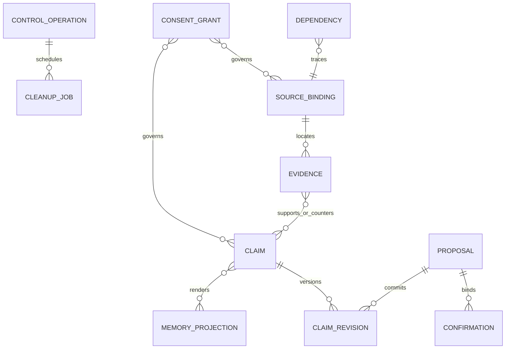

# 状态、API与存储：把语义落到边界

本文给实施者一个可拆解的合同。数据库表名和API都是公开设计示例；[OpenAPI](../../api/openapi.json)与[提案Schema](../../schemas/proposal.schema.json)可用于结构讨论，不代表仓库已有服务、鉴权器、Reducer或迁移。

## 1. 权威与投影



图只表达关系职责；多态引用不能只在JSON里写一个ID。可以用实体注册表、分类型外键或事务内确定性校验，但都要覆盖owner、类型、版本、删除竞态与孤立引用。

一个字段拥有多个合法情境版本很正常。“最新写入一条”不天然替代其他情境。冲突键至少要考虑主体、字段、适用时间、情境和视角，不能仅用(subject,field)唯一约束把事实压扁。

## 2. 建议表组与访问路径

| 表组 | 主职责/约束 | 核心查询方向 |
|---|---|---|
| account_memory_state | owner唯一、聚合revision、consent/deletion水位，事务CAS | owner精确点查；路由epoch独立 |
| source_binding / evidence | 片段/原版本/代码点坐标、保留/谱系、说话者与独立组 | owner+source+revision；owner+independence_group |
| claim / claim_revision | 受管值、性质、范围、支持、生命周期与历史 | owner+subject+field+lifecycle；revision唯一 |
| claim_evidence / contradiction | 支持与反证边、冲突类型、处理状态 | 从Claim批量查依据；从Evidence查受影响Claim |
| memory_projection | 用途受限展示/召回，不独立改事实 | owner+type+scope+status+稳定分页键 |
| proposal / confirmation | 精确提案hash、展示与确认版本、有效期限 | owner+status+expires_at；精确proposal查回 |
| consent_grant / consent_event | 用途/接收方/记录范围和当前授权事实 | owner+purpose+audience+current状态 |
| dependency | basis/独立支持/保留绑定/出处/显示/任务条件 | 按父找下游，按子核根；两向有界索引 |
| operation / outbox / consumer_receipt | 原key回读、投递一致性与消费去重 | owner+operation_type+key唯一；next_run_at |
| deletion_ledger / cleanup_job | 独立停止覆盖与声明副本清理 | scope/epoch、deadline、lease/fence与副本版本 |
| usage / audit / export | 最小用量控制、操作回执、受管导出 | owner/时间分区；正文不默认入日志 |

文本、JSON、列表、依赖展开和导出都要有明确上限。存储版本用足够范围的整数，API按十进制字符串传输；金额用定点或最小货币单位，未知费用不填0。

## 3. 确认请求的边界

以下示例只确认一个服务端已经准备的提案，不接受客户端自填owner、verified、active、接收方授权或任意field路径。

```json
{
  "proposal_ref": {"entity_type": "proposal", "id": "example-proposal-a", "revision": "1"},
  "confirmation": "confirmed",
  "selected_purposes": ["long_term_personalization"],
  "source_retention_choice": "retain_minimal_quote",
  "expected_versions": {
    "model_revision": "4",
    "consent_version": "2",
    "deletion_epoch": "0",
    "objects": [{"entity_type": "proposal", "id": "example-proposal-a", "revision": "1"}],
    "schema_version": "memory-contract-public-v0.2",
    "registry_version": "account-memory-fields-public-v0.1",
    "policy_version": "example-policy-v0.2"
  }
}
```

宿主还需绑定认证动作、服务端披露版本、精确内容/性质/范围/依据版本和原幂等key。JSON里的selected_purposes只是选择，不是已经生效的Grant。目标接收方由受信服务配置和UI披露绑定，不能因用户选择一个字符串就向任意新服务发送。

新值或依据改变后不能沿旧确认激活；只有无关条目变化引发聚合CAS冲突时，重读/预览后可保留仍精确有效的确认。不要让所有冲突都逼用户重复解释，也不要把一次确认变成对未来未知内容的许可。

## 4. 模型提案与人类命令分开

模型提案只引用当前宿主发出的source_handle与已有实体引用，输出本地候选ID。真实持久ID由服务端生成。模型不能创建Grant、确认事件、控制登记或动作成功回执。

本版提案Schema刻意只表达证据片段和Claim候选，不提供任意SQL/JSON Patch，也不让模型直接声明“停止已生效”。真正更新操作由宿主对照当前权威状态准备；明确本人停止经控制入口独立执行。

结构合法、字段已注册、字段当前enabled、来源真实可读、作用范围允许和最终事务可提交，是不同检查。Schema能拒多余owner字段，却不能证明source_handle背后仍有许可。

## 5. API操作表

| 接口 | 输入亲本/结果 | 重要失败 |
|---|---|---|
| GET /v1/memory/management/entries | 认证本人、过滤/keyset → 最小管理项/coverage | cursor失效重开；不返已删正文 |
| POST /v1/memory/context | 受信宿主的任务、用途、预算 → bundle | 权威不可核则历史失败关闭；超限说明不足 |
| POST /v1/memory/proposals/{id}/confirm | 精确提案、内容/用途选择、expected → save_state | 缺许可awaiting_grant；缺支持不靠确认解决 |
| POST /v1/memory/corrections | 明确动作、目标、替代引用、expected → 分项回执 | 停止先成立，替代失败不恢复旧使用 |
| POST /v1/memory/controls/stops | 明确受管对象/范围、原key → 阻断/登记结果 | 不要求恢复原AI Grant；身份不可核仍拒绝 |
| POST /v1/memory/deletions | 声明清理范围 → 控制与分副本进度 | 202不是已全删，未知查原operation |
| GET /v1/memory/operations/{id} | 原operation ID → 当前允许结果 | 不重派模型、不重放已删payload |

OpenAPI中的认证方案是接口描述，不是安全实现。内部context端口还需要宿主能力绑定；普通客户端不能凭一个用户Bearer获取整份模型上下文。

## 6. 错误与重试分类

| 错误/状态 | 调用方应怎么做 | 禁止的补救 |
|---|---|---|
| 428 PRECONDITION_REQUIRED | 补齐必需版本并重读范围 | 服务端偷偷用最新版替代调用方意图 |
| 409 STALE_WRITE | 重读差异、必要时重新预览 | 原payload无限自动重发 |
| 403/不可枚举404 | 核对本人的用途/对象 | 自动换owner/接收方/用途 |
| 422 FIELD_DISABLED/INVALID_REFERENCE | 修改提案或等待明确扩展 | 把字段改写为自由text绕过目录 |
| 202 RESULT_UNKNOWN | 查询原operation/provider_request | 换key重新调用付费模型或副作用 |
| 429 BUDGET_EXHAUSTED | 停额外模型工作/公平等待 | 用其他供应商或绕过控制 |
| 503 AUTHORITY_UNAVAILABLE | 受影响历史失败关闭，必要时当前输入降级 | 用旧缓存假装当前合法 |

停止/删除对明确范围可作单调推进，不因无关账号revision变化反复拒绝；扩大范围或改变意图仍需重新绑定。退出能力与模型额度分开，但不等于免认证或没有防滥用限额。

## 7. 迁移与回退

先对新记录建立完整闭环，再对旧记录预检来源、性质、主体、许可和最小来源保留。用户看到可升级条目和限制，按明确选择迁移。映射key包含owner、原ID/版本和目标合同版本，重复执行不复制。

影子投影只能处理已有权范围的数据；数量一致不证明语义等价，需检查丢失反例、错误性质升级和删除复活。旧记录没有来源时不从AI摘要补造原文。

回退关闭新发现/写入/向量等计算能力，保留安全管理、有效数据的受限读取/导出和当前控制水位。已经被失效的旧投影不能因切回旧代码重新生效。
