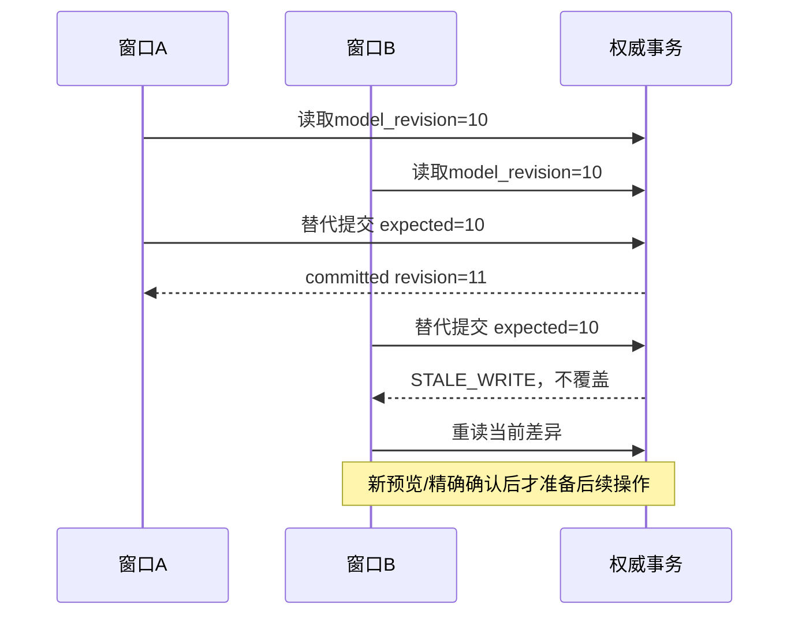

# 并发与恢复：把失败当作合同的一部分

本章推演设计应有的行为，不声称已完成数据库或多实例故障试验。每一条推演都应在实现时转化为有环境、版本和原始证据的试验。

## 1. 三个不同的“原子”

- **内容事务原子性**：合法替代的旧新版本、依赖、Outbox和幂等回执一起提交。
- **控制意图的可恢复性**：每一个向用户承诺成功的停止，独立于旧业务备份仍能重放。
- **结果提交的当前性**：用旧来源生成的迟到答案不能绕过新控制水位提交。

单个数据库事务不能自动覆盖外部模型和独立登记；“最终一致”也不能给撤回后继续使用留一个任意宽限。

## 2. 两个窗口同时更新



账号聚合revision的粗粒度CAS可作为首版安全起点，同时记录对象revision以量测冲突率。之后可缩小关系/议题分区，但不能为减少409去掉授权和删除水位检查。

多对象锁按稳定顺序获取，模型等待不占事务锁。查询、预览与真实提交分开，预览成功不保证稍后的提交仍有权。

## 3. 停止与派发的竞态

| 顺序 | 允许什么 | 结果 |
|---|---|---|
| stop先于dispatch admission | 当前水位拒绝旧来源 | 不派发旧请求 |
| admission先成立，stop随后到达 | 已合法准入的在途单列，发前尽力取消/核变化 | 不承诺已外发字节可追回 |
| output先收到，stop先于final commit | 最终提交再核水位 | 丢弃受影响输出，不推进游标 |
| final commit先于stop | 先前有效交付真实记录，随后停止未来使用 | 不能把已发生交付改写为从未发送 |

准入点与停止按同一权威控制顺序比较，通知只是加速。不要把两次RPC之间的空隙描述成不存在，也不要为封住网络等待而长期持账号数据库锁。

初始答案正文缓冲到最终准入。未来流式输出必须定义逐段准入和重连；最终丢弃不能证明早先展示部分不存在。已经交付的部分若变过期，应准确标中止并清理受管临时副本。

## 4. 停止协议的崩溃矩阵

| 崩溃点 | 恢复依据 | 新使用与回执 |
|---|---|---|
| 独立意图还未持久 | 原请求身份和当前控制事实 | 不报停止成功；控制未知保守阻断受影响范围 |
| 意图已持久，业务未应用 | 独立意图序列/范围 | 先重放业务屏障；不先开放旧读 |
| 业务已应用，独立收口未完成 | 原意图+业务操作回执 | 原key恢复收敛，不造另一个删除操作 |
| 成功ACK发出后响应丢失 | 独立持久覆盖+原operation | 查询原结果，不重复执行或恢复正文 |
| 清理worker中途失败 | 每副本/版本进度与lease/fence | 停止保持；从未完成批次续跑 |
| 恢复早于停止的业务快照 | 最新独立控制登记 | 先重放水位，覆盖核对通过才准入 |

独立登记要说明故障域：与业务库同一个可回滚备份里的Outbox不能证明独立。复制、保留、恢复准入、认证与最小化要共同设计。RPO/RTO必须通过实际拓扑演练，不能因有多份备份就推导RPO=0。

## 5. 停止先成立，替代后失败

```text
parent operation example-correction-a
  stop operation: blocked + independent durable
  replacement operation: transaction rolled back
  parent intent: not fully completed
  replacement_save_state: failed
  result_code: STOPPED_REPLACEMENT_FAILED
```

父operation整体未完成不能标committed来暗示全成，也不能把已成立的控制写成全失败。后台重评不得自动解除用户停止；新本人说明有独立来源，但保存仍需合法门控。

## 6. 幂等的几个域

| 域 | 幂等绑定 | 为什么不能混用 |
|---|---|---|
| 用户确认/纠正 | owner+operation_type+key+规范化意图/预期版本 | 同key改范围不应静默被当作原操作 |
| 模型派发 | 原operation/provider_request+wire绑定 | ACK丢失不代表没发生费用 |
| 业务行动 | Action.operation与工具真实回执 | 模型输出不是消息已发送 |
| Outbox消费 | consumer+event_id及聚合revision | 至少一次投递不能重复改状态/扣费 |
| 历史迁移 | 原ID/version+目标合同版本 | 重跑回填不复制记忆或增加支持 |

幂等响应也属于删除面。旧操作查询可以说明“曾提交、当前已停用”，不能原样返还已删正文或旧许可。恢复窗的最小ID/键需有明确政策，不把正文指纹当永久墓碑。

## 7. Lease与fence

worker领取任务取得短租约和单调fence；心跳、完成和写回均验证当前fence。旧worker暂停后复活，即使手里仍有完整输入，也不能覆盖新状态。

任务同时绑定来源/许可/删除水位、parent budget、deadline和extractor/policy版本。领取合法不保证派发或提交时仍合法，三个时刻均重核。取消不退还尚不能证明未发生的费用。

队列按控制清理、前台必要投影、普通索引、可延期整理分优先级；为控制保留资源并做账号公平调度。至少一次任务系统不自动提供端到端恰好一次，仍需上述业务幂等。

## 8. 高扇出删除

如果一个来源支持很多摘要、报告和索引，不应先遍历完所有下游再阻断。先登记根/域范围和新epoch，在读取准入中检查其覆盖；然后分批清正文和闭包。

派生物必须能证明其全部必要根仍合法。缺少依赖元数据、超深/超扇出或闭包尚未完成时，停用受影响投影/范围，不根据“没遍历到”证明无依赖。

存在独立合法支持时可以重新计算新投影；不是只从数组移除已删反例就让旧结论自动active。若旧粒度无法安全分片，整份投影保守停用并如实说明。

## 9. 运行手册应回答什么

| 事件 | 自动动作 | 应保留的最小证据 |
|---|---|---|
| 控制登记不可核 | 历史读写失败关闭，退出原操作处理中 | 影响范围、当前水位差、原operation |
| 主库失联而缓存有正文 | 不用无法证明当前性的历史缓存 | 拒绝/降级量、恢复前水位核对 |
| 索引严重落后 | 有界权威增量/回源或明确不足 | 连续水位、积压年龄、查询预算 |
| 清理超过声明期限 | 告警，优先清理，必要时限制新保存 | 每副本状态/重试/失败，不假称全删 |
| 供应商超时 | 原派发未知，不自动重发 | 预留、可观测usage、provider_request |
| 策略回退 | 关新增计算能力，保治理控制 | 版本映射、失效投影与退回边界 |

日志默认无私聊、完整提示词、心理标签或可反推短文本指纹。为了诊断确需正文时，另有最小范围、期限和清理合同。
