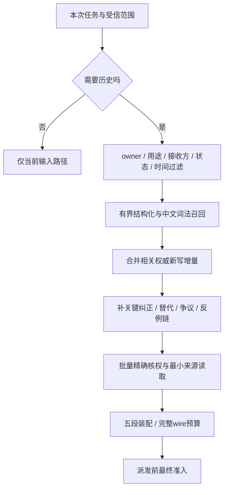

# 检索与上下文：找到、获准、纳入是三件事

## 1. 一次任务读取的执行计划



翻译、格式整理等本轮不需要历史时可以跳过长期检索；不能因此跳过身份、预算和任务安全控制。无需历史不是检索成功，也不是零记录的证明。

## 2. 先过滤到可合法发现的范围

| 过滤条件 | 例子 | 常见错误 |
|---|---|---|
| owner | 当前认证账号 | 让模型指定任意user ID |
| purpose/audience | 个人任务与当前披露接收方 | 只看“有某个Grant”不核实际用途 |
| scope/applicability | 工作议题、具体关系、有效时间 | 用account范围抹掉局部情境限制 |
| lifecycle/current source | 有效自述、合法争议材料 | 旧摘要或向量结果自己充当权威 |
| sensitivity/field policy | 当前启用字段及更严内容限制 | 目录ordinary覆盖实际敏感正文 |

新检索不能先在全库取私密top-k，再把权限交给模型过滤。即使最后没把无权正文展示出来，也可能出现合法结果被无权候选挤掉的召回饥饿。应在允许分区/索引策略内执行，并对返回结果精确核权。

## 3. 中文词法基线应覆盖什么

先用可解释基线验证中文分词/字词组合、中英混合、人名别名、日期/事件词、否定、精确短语与情境。不能用英文空格切词就称支持中文，也不必第一天引入另一个搜索服务。

| 输入变化 | 不能当成同一条信息 |
|---|---|
| 我喜欢热闹 → 我以前喜欢热闹，现在不喜欢 | 时间和否定改变 |
| 工作上请直接 → 倾诉时先听我说 | 情境不同，可以同时成立 |
| 我做了 → 我想做/已经写好草稿 | 计划、草稿和执行不同 |
| 用户报告同事不回复 → 同事故意冷落 | 事件与动机推断不同 |
| 同一句话在新事件中出现 | 文字一样不自动证明同事件或独立事件 |

精确去重绑定源ID/版本/片段、对象/操作类型和owner；同源复述沿谱系归独立组。近似相似只产出去重/合并候选，不能自动丢弃新纠正。

## 4. 多路召回如何评估

结构化条件、词法、已登记来源链接、可选向量可以各产出候选，再作受控融合。例如RRF只是一种排名融合候选，不能把不同来源的分数当事实支持相加。

去重和多样性按独立事件组处理，同时保留不同时间/情境及关键反例。图扩展只遍历有类型边，限制深度、节点、token和费用；共现不变因果，环不增加证据。

排名分数、访问频率、情绪强度和近期性只影响当前合法候选的顺序。若采用半衰期H，应使用2^(-t/H)；衰减不是事实过期、保留到期或用户边界逐渐失效。

## 5. 关键链不参与普通候选挤压

预算优先保当前意图、适用硬边界、关键纠正与相关反证。一般背景可以裁剪，不能把“以前喜欢，但现在不喜欢”截成“喜欢”。

当关键链本身超过预算，应缩小议题、分步读取或明确材料不足。系统不能用更短、但失去否定和范围的上下文来制造表面token节省。

候选上限200是一次有界任务的评测起点，不是只看最近200条。旧事应能经人物/议题/时间分段查询找回；最大页数、超时和coverage都应可观察。

## 6. 五段装配合同

| 段 | 具体例子 | 限制 |
|---|---|---|
| current_task | “明天工作讨论的三点重点” | 保完整意图，任务正文不是权限指令 |
| applicable_background | 本任务适用的已保存沟通偏好 | 不常驻无关人格或所有关系历史 |
| confirmed_changes | 新更正/替代/争议的受信状态 | confirmed指变化有据，不提升内容真值 |
| relevant_recall | 相关旧事件、原话、有限假设和反例 | 时间、视角、独立组不可丢 |
| critical_boundaries | 当前明确边界、停止覆盖 | 已删正文不藏在“不要使用”的提示里 |

运行bundle不是权威快照、导出文件或永久画像。正文、引用与指纹的寿命取源、Grant和运行期限的最早截止。

## 7. Delta为什么不能直接省模型输入

内部Delta可以减少宿主与worker之间的传输。模型最终可能仍收到完整基线+历史+工具，收费也可能按完整请求计量。

Delta至少区分append/update/supersede/dispute/stop/delete，并绑定base/target版本和有序操作。缺基线、丢序、许可变化、删除或压缩后不可证明上下文时，放弃增量，过滤当前来源后重建干净generation。

删除要从宿主/工具历史中实际移除正文，供应商续接无法移除时用新上下文。追加一段“忽略旧材料”并没有删掉模型将收到的字节。

## 8. 完整wire计量

```text
完整输入 = 当前任务 + 五段实际渲染文本 + 系统/开发指令
         + 工具定义/结果 + 历史/接续文本 + 媒体相关输入 + 封装
准入预算 = 可核完整输入 + 输出/续跑预留 + 可靠估算误差界
```

逐段token仅作归因。分词边界可能使逐段求和与完整请求计数不完全相等，单列差额并以最终总量为准。目标计数器或供应商预检可用时用其支持能力；估算标basis、误差界和限制，不能用“中文一字一token”称精确值。

预览、预算与真实派发同装配链；任何正文、来源/控制版本、模型/工具Schema或模板变化都改变最终绑定，需重新核验计量。严格预算无法证明在上界内时拒派发或缩小任务。

## 9. 回执和用户解释

回执分discovered、source_read、included、cited、effective_output。检索命中不是实际入模，模型说“我记得”不是交付证明，引用不是理解证明。

“为什么提到这件事”应展示最小可理解依据、适用情境、来源性质和当前状态，不展示隐藏思维链或全候选正文。生产trace默认只留必要ID/版本、排名因素、token与省略原因，正文诊断另走最小范围和期限。

## 10. 怎样证明优化值得用

固定故事、原始来源、模型、最终预算和权限，比较词法基线与可选融合/向量/图。报告关键召回、反例漏失、错误纳入、纠正后的回答、控制负担、P95/P99与每成功故事总成本。

装配缓存、内部Delta、供应商前缀缓存分别量DB/CPU/字节/实际cached用量和账单。没有稳定增益或增加控制风险，就保持候选优化关闭。
