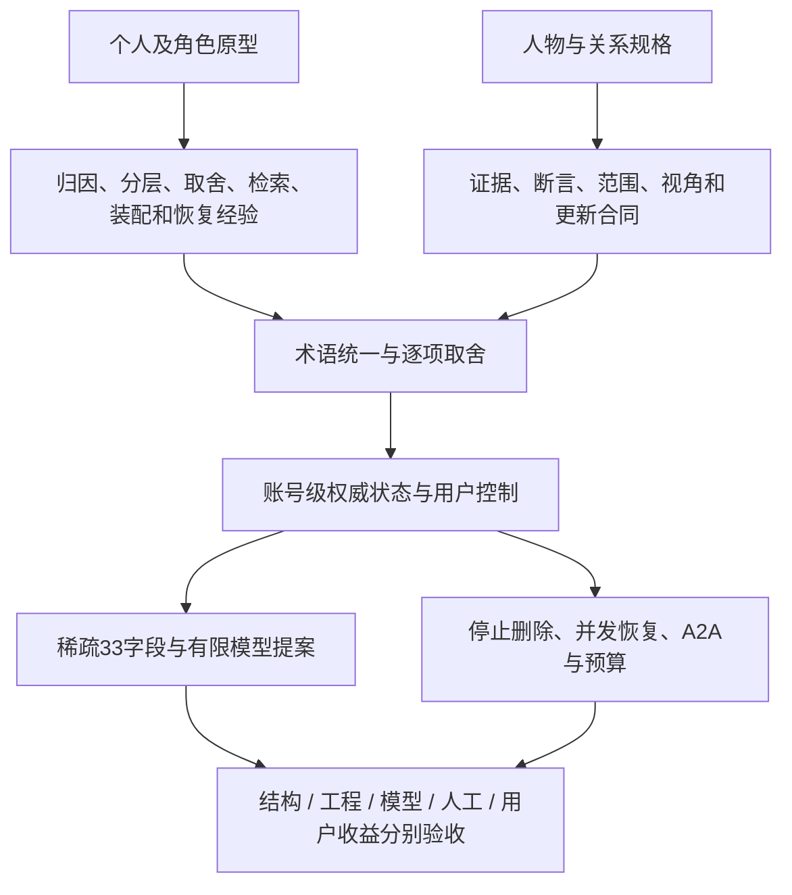

# 参考机制怎样进入一套完整记忆设计

本章将多种个人记忆原型、角色系统和人物理解规格重新组织为匿名分析，不附作者、原件、代码、原报告或出处。讨论重点是：各机制解决什么问题，哪里不能直接兼容，扩到账号服务时需补什么，怎样验证。分析来自本地静态审阅，**没有运行外部软件或独立核验其历史效果**。统一术语见[冲突说明](../../references/UNIFIED-INTERPRETATION.md)，逐字段限制见[105概念表](../../references/FIELD-CROSSWALK.md)。

## 1. 三个层次不能混成一套能力声明

个人记忆文件擅长透明、可编辑与快速试验；角色系统擅长长期表达与情境连续；人物理解规格擅长显式表达证据、视角与更新。运行环境清单、经验文章、脚本、Schema和历史报告分别提供不同证据。依赖清单不是领域模型，Schema不是授权系统，原型运行结果也不是千万账号服务的验收。

这个映射表示职责关系，不表示本项目独有原创，也不表示所有输入都采用。当前主设计仍是设计合同与结构示例；真实模型、数据库、多实例、真人反馈和账单需另行验证。

## 2. 身份和上下文隔离：多开窗口并不足够

不同会话可能已经隔离，但它们仍能通过共享记忆库、文件、工具和通信账号相互污染。开发时的一次调试话语可能进入陪伴角色的长期背景；某个角色写的自述也可能被误当真人资料。因此应分别处理会话、记忆、文件与通信身份，而不是只检查聊天窗口ID。

采用的原则是：每条写入主体可查、工作侧影响长期记忆先走候选、角色设定与真人事实分开。目标模型中，真人Evidence、角色状态、方法记忆和任务Action不共用隐含权威。相同真人事实可以形成有权视图，不必给每个角色复制正文；同一条话被多个Agent转述也不增加独立证据。

需要收窄的做法是依赖可写的by／source字段判断真实身份，以及迁移时将空作者默认归给角色。内容归因保留为声明，actor／owner由受信宿主填；未知保持未知，不通过补默认值让审计看起来整齐。角色自动同意或在候选池点头也不能代替真人账号主体授权。

部署文档还应区分宿主、运行时、记忆组件与可选通信桥。“无第三方模块”只说明某个组件依赖少，不意味着没有运行时、网络提供方或运营成本。工具总数也不能当作记忆能力指标。对应主合同为[Agent与身份边界](06-a2a-and-agent-boundaries.md)，验收看T07与T28。

## 3. 原话、索引和注入分工：最可复用的基础

一种常见的有效演进是：原文按记录追加，建立可重建全文索引，再按任务挑少量内容注入。它避免把全部历史塞入提示词，也让原话与摘要可区分。中文词法、结构化过滤、时间因素与有界结果可以先形成可解释基线，再判断可选向量是否有独立收益。

这条路线值得保留，但“原文是唯一来源”只应表达原话出处，不能把一句陈述自动提升为客观真相。SQLite或其他索引也不能拥有独立修改事实、授权或删除状态的权限。新纠正未索引、索引乱序有洞或缓存过期时，最终准入仍要回权威状态核对。

本地静态审阅暴露过一个重要恢复风险：纠正写在数据库表里，备份却只复制原文、核心页和原文副本。这样的备份能重建文字和词法索引，却未必恢复纠正语义。恢复是否完整，应按不可重建的内容、控制事件和许可版本逐项证明，而不是只看备份压缩包成功生成。这个判断限于显式代码路径，本次没有运行破坏性恢复试验。

另一个风险是把原文里的软删除标记当最终控制：导入看不到标记就将既有deleted重置为active。这适合可撤销归档，不能实现账号删除；旧备份恰恰可能缺少后来新增的标记。因此需独立停止登记、删除epoch、恢复前重放、受管副本清单和缺证关闭。

个人脚本中的临时文件、fsync、rename和本地锁能覆盖部分故障，却不能证明数据库、队列、对象存储和提供方之间的原子性。按锁龄清理也不意味着旧进程停止。扩到多实例需要版本CAS、幂等、lease与fence，确保过期worker没有提交能力。

对应[存储与接口](03-api-and-storage.md)、[恢复](04-concurrency-and-recovery.md)、[检索](05-retrieval-and-context.md)，以及T10–T15、T20–T25、T31–T32。原型的库体积、注入条数和运行速度不外推为规模指标。

## 4. 分层记忆与双强度：排序价值不能变成事实权力

把事件、人物视图、行动账本和原话分别组织，能解释“记住发生了什么”“如何理解这个人”“事情做到了哪一步”。这些是逻辑职责，可以共享有来源正文，不要求每层各存一份。原话来源、事件时间和写入时间需可追溯，账本完成也不能替代现实完成证明。

双强度将长期重要程度与当前容易被提取的程度分开，避免一个分数同时承担重要、近期和真假。检索强度可以衰减，命中可以回升，明确置顶可以影响排序；这适合作为可解释排序假设，仍需要与无反馈基线比较。

采用时必须限制三种误用：命中次数不能提高支持独立组；高重要度不能豁免保留和删除；衰减也不能让关键当前边界失效。反复被模型挑中的条目容易自强化，应检查冷门重要事实和反例是否被压下去。若每命中都回写，还要计算写放大、热点与批量／惰性更新成本。

对纠正也不能只有自由字符串。静态观察中存在文档称withdraw停止检索、实现却恢复可见的情况。目标设计要明确操作对象：撤销某次更正、停止使用、删除原记录分别定义，不把同名命令直通API。

内容指纹和链式校验有助于在基准受保护时发现变化，但没有独立受信锚或签名，不能证明作者、事实真实性或抵抗有权重算整条链的人。完整性异常要有宿主可观察告警，不能只放进角色日记等待模型注意到。对应T08、T09、T10、T28。

## 5. 阶段整理：从“有库”走到“会在合适时用”

日记、次日精选、每周补漏和一页时间目录构成直观的阶段记忆法。它的贡献是给整理和检索安排动作；缺口往往在何时触发、如何判断重要、怎样证明没有遗漏、删除后依据是否仍合法。

账号服务不宜将这个节奏直接翻译为每账号每日LLM任务。更实际的触发包括：新增明确偏好、用户请求保存、任务阶段结束、有预算的复核或发现冲突。用增量水位、幂等作业、截止时间和配额处理，离线／不活跃账号没有合法新输入时不应空跑总结。

阶段摘要与目录都是派生物，必须继承来源用途、保留、独立组与删除关系。原文删后，目录里的概述不能变成独立证据，也不能为了“保持连续”保存可重建应删细节的摘要。候选复核、新鲜度、存储保留和授权期限分别控制，不共用一个TTL。

整理还可能产生新的推断。模型可以提出候选和理由；本人明确偏好可以按reported承接，但一次情绪、自嘲、引用或角色模拟不固化为稳定人格。短确认词不能在不清楚对象和范围时当作全权批准。对应T02–T06、T08、T16、T27。

## 6. 取舍、拒绝和协作看板：需要解释，也需要预算

有用、珍视、承诺和拒绝回答不同问题。一个条目可能对眼前任务有用但无需长期保留；另一个有情感价值却不需要每轮注入。将它们拆开，用户才能理解为什么留下、为什么没有提起。

拒绝记录应表达范围、原因及可重提条件，而非只留一句结论。这样可以减少反复询问，也便于纠正。但拒绝记录本身仍有敏感性和删除义务，不能为了避免再问就保留完整拒绝对象和原话。删除后的最小控制登记需要防重建正文。

双进程工作板和候选池能让一个Agent提出信息、另一个处理，但文件写入成功不证明来自可信身份。所有跨Agent输入先按其实际来源和权限解释；看板常驻模型上下文也产生真实输入成本，不能从成本表中漏掉。

可视化可以帮助定位记忆与出处；连接应基于明确实体、事件或关系，不用文本相似度冒充真人关系。只画少量用户选择的条目也不表示其他条目不存在。备份需要实际恢复演练，测试目录和真实目录分开；回归答案留在待测模型上下文之外。对应T08、T15、T27–T30及[独立评测](07-evaluation.md)。

## 7. 单一装配者与模块故障隔离：采用工程职责，保住控制边界

记忆、角色自我调整与表达状态分别产生片段，最终由单一装配者决定放什么、放多少。这个职责比让每个模块自行插prompt更容易控制预算、追踪来源和定位错误。相同有效状态生成稳定片段，有助调试、局部差量和可能的真实前缀缓存。

最终装配应记录每段的依据版本、用途、字符／token、纳入或遗漏原因；任何工具、媒体、模板、模型或控制版本变化，都重新计量与准入。稳定片段不代表可以在撤权后继续缓存派发；Delta省传输字节也不等于供应商少收费。

故障处理必须分层。可选角色情绪不可读，可以省略该段；长期保存失败，需要明确回执、跨轮计数和熔断；Grant、删除、来源或严格预算不可核对，必须关闭相应历史能力。返回空值后继续读旧缓存会破坏用户控制。恢复不能只看“对话没崩”。

反思可以有触发条件、有限问题、受限产量、证据存在检查、跨时段要求和候选状态；禁止把自己写的反思再当新独立依据。给派生结果降权并不足以解决证据循环，仍需来源独立组和反向依赖。

角色需求、防御、依恋、发展阶段和情绪参数属于表达模型。它们不构成真人心理测量，不默认进入匹配、敏感画像或A2A。角色可以在宿主允许范围调整表达，不能解除权限、费用、频率、并发、保留和真人退出界限。只归档不删除的角色观念也不能覆盖账号删除合同。

对应T06–T08、T18、T23–T28，以及[上下文](05-retrieval-and-context.md)、[A2A](06-a2a-and-agent-boundaries.md)。

## 8. 人物与关系模型：完整规格不等于全量建档

结构化人物理解可以把证据、说法、认识性质、支持与反证、有效时间、关系方向和修订表达清楚。它适合防止一句摘要固定一个人；风险是理论目录太完整，诱导默认填满、把未知猜出来或给真人做未经验证的心理排名。

主设计保留稀疏字段和有限提案，不要求所有用户建立人物档案。关系不是单人属性：谁对谁、什么议题、哪个时间、谁的视角都不能丢。本人的关系感受可以是reported，不能证明对方内心。目标、叙事、能力、行动与结果也需要独立对象和证据，不能都塞进自由field_id。

[105类概念表](../../references/FIELD-CROSSWALK.md)逐项说明承接：23关闭扩展、26条件语义映射、5保留原话或局部假设、8独立对象映射、12对象投影、2窄化本人自述、3入口适配后开启、1敏感专项关闭、3同名受限映射、14关系扩展待审、8关闭研究。总数105；目标仍33项、初始21开12关，所有行禁止自动导入。这些类别是设计处置，不是已开放能力数。

具体适配不能省略：

- 源概念若接受推断，目标却只接reported text，同名也不兼容。不能靠改标签获得本人自述地位。
- 输入boolean、category或measurement不能统一字符串化。event.description目标是Event引用，须先建立合法对象。
- 一般身体状态不等于身体不适；价值分类不等于本人明确表达；能力自述不等于稳定技能，单次结果也不证明掌握。
- 人生章节与意义需要有源NarrativeSegment；目标判据、约束、依赖与状态归GoalContext；截止日期不自动创建提醒。
- 关系多维视图保方向、情境、证据和时间。安全、权力与依恋体验需更严策略，不能藏进万能扩展规避关闭。
- 测量和发展研究需单独合格合同与效果证据，默认关闭；三事件／十四天／两情境仅可作为防过早泛化的候选门，非科学充分条件。

静态验证器可以检查结构、引用、内存Grant记录和部分状态，但不能证明现实同意、原话真实性、数据库并发、物理删除或现实行动。文档策略文件存在也不表示代码已加载；active inferred若仅检查确认而不检查supported，仍不满足主设计。原报告的通过数不转成本项目结果。

对应T03–T09、T16–T17、T29–T30；字段与值详见[目录](../04-field-registry.md)和[机器合同](10-machine-contracts.md)。

## 9. 千万注册用户：按活跃负载和全成本取舍

规模改变调度、存储和账单，不改变出处、用途和停止语义。先测活跃人数、每人会话、记忆调用比例、写入率、对象／来源大小、存储天数、模型分布、扇出和副本，而不是给注册总数乘一个全天在线Agent。

| 个人原型机制 | 保留的目的 | 规模实现需补／替换 | 费用和风险 |
|---|---|---|---|
| 每日／每周全量整理 | 复核和补漏 | 活跃事件触发、增量水位、幂等、截止与配额 | 输入／输出、调度、重试、不活跃账号空跑 |
| 每账号文件／本地DB | 可编辑导出、回放、局部测试 | 账号分区权威、索引投影、大账号隔离、控制优先 | 小文件与元数据、随机IO、索引放大、恢复窗口 |
| 命中强度回升 | 可解释排序实验 | 批量／惰性计算、反馈限制、独立对照 | 每命中写放大、热点、冷门反例漏失 |
| 全量原文及多份备份 | 来源定位和恢复 | 明示保留、最小片段、派生清单、恢复前重放停止 | 原文、向量、摘要、导出、副本和清理作业 |
| 内核／看板常驻 | 连续性和稳定片段 | 按任务最小字段、最终预算、可核验缓存 | 所有可见输入、工具定义、结构输出、额外调用 |
| 多进程／Agent自治 | 分工和候选协作 | 父任务、受信actor、Grant、接收方、期限和预算 | 扇出、重复读取、对方保留与远端删除证据不足 |
| 全人物表／角色模型 | 可选理解和表达 | 先有任务收益，再有独立策略和实验 | 错误画像、确认负担、敏感存储、跨用途扩散 |

[经济性章节](09-capacity-economics.md)给出可复算假设；它不是现实报价、真实账单或千万用户压测。是否启用向量、图、夜间整理、多Agent和人物扩展，要看固定任务、来源、最终预算下的增益及总成本。超预算时可以减少候选、关闭可选层或拒派发，不能降低控制正确性。

A2A仅交换任务必要的授权投影，绑定目的、字段、接收方、父任务、期限和预算。对方回执不能证明其所有副本都已物理清除；外发能力与长期训练许可独立。用户能够停止和删除的边界要在接入前说清，不能用对方自报成功补证。

## 10. 公开成果与下一步验收边界

本版完成匿名机制整理、术语统一、冲突解释、105类概念对照和对应离线检查。它没有附带其他人的原文件或出处，没有执行外部软件、导入真实记忆、改业务源码或调整生产配置。

目标33字段、21开12关、3份Schema与9接口合同保持既有范围。新增检查只证明公开整理和字段对照一致；[T01–T32](../06-acceptance.md)仍需目标实现逐项举证。结构正确、工程恢复、真实模型、人工判断和用户任务收益不能互相代替。
